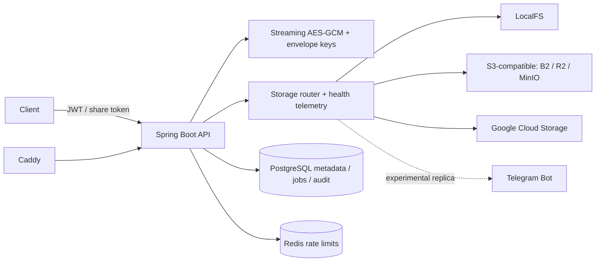

# ShardVault

ShardVault is an encrypted file storage service built around pluggable storage providers. The API encrypts file chunks before writing them to a provider; metadata, ownership, replication state, shares, quotas, and audit events live in PostgreSQL.

## Architecture



## Security model

- File contents are encrypted in chunks before provider writes. Providers see ciphertext and opaque object keys.
- Passwords use Argon2id; access JWTs are short lived. Refresh tokens and share tokens are stored as hashes. Refresh credentials use secure, HttpOnly cookies.
- Authenticated resource operations are owner scoped. Public share access is token scoped and rate limited.
- Providers are configured with credentials from environment or cloud application credentials. Provider administration stores environment variable names, not secret values.
- JSON logs include correlation IDs and intentionally omit message bodies and exception details to avoid logging credentials, tokens, keys, or filenames.
- Production ingress is Caddy. Actuator health is used for internal health checks; do not expose management endpoints directly to the public internet.

See [docs/security-review.md](docs/security-review.md), [docs/providers.md](docs/providers.md), and [docs/routing.md](docs/routing.md).

## Local development

Requirements: Java 21 and Docker. Maven Wrapper downloads Maven and dependencies on first use.

```powershell
Copy-Item .env.example .env
docker compose up -d db redis
.\mvnw.cmd verify
```

For a production-shaped deployment, copy `.env.example` to `.env`, set strong unique secrets and a DNS name, then run `docker compose -f docker-compose.prod.yml up --build -d`. Caddy needs ports 80/443 reachable and `DOMAIN` pointed at this host to obtain HTTPS certificates. The default provider in this compose file is persistent local storage; set provider credentials/configuration for external storage as required. Monitoring is optional: add `--profile monitoring` and set `GRAFANA_ADMIN_PASSWORD`.

The initial setup is not currently a verified clean-VM release: database migrations and application boot must pass the CI workflow before using this as a production service. See the current verification status below.

## Tests and operational tools

```powershell
.\mvnw.cmd verify
```

Provider integration tests activate only when the corresponding environment variables are present. Load and failover scripts are under `infra/scripts`; read their required variables before running them. CI runs Maven verification and a Trivy dependency/image filesystem scan.

## Benchmarks

No reproducible benchmark has been run yet. Throughput and latency depend on encryption chunk size, provider, network, and replication policy; do not use estimated numbers for capacity planning. Record environment, file size, concurrency, throughput, and p50/p95 latency when publishing benchmark results.

## Design decisions and tradeoffs

- Chunked streaming limits memory use and makes provider failover possible, while adding metadata and per-chunk scheduling overhead.
- Synchronous first-copy writes make newly uploaded data available promptly; additional replicas are asynchronous, so IMPORTANT/CRITICAL data may be temporarily DEGRADED.
- Telegram is experimental and has a small maximum chunk size; its reliability tier excludes it as the sole copy.
- PostgreSQL outbox jobs survive restarts, at the cost of requiring operational queue monitoring and dead-letter repair.
- Caddy automates HTTPS but requires a public DNS name and reachable ingress ports. Local development can use the direct API instead.

## Verification status

`mvnw verify` passes locally. The run covered 8 crypto tests, 12 storage tests, and 6 API unit tests; 25 real-provider contract tests were skipped because provider credentials were not configured. Docker is not installed in the current environment, so Compose validation, container-backed end-to-end tests, and the MinIO chaos scenario have not run. The current API does not expose general file upload/download endpoints, so the k6 script currently exercises public share downloads only. No k6 report or measured benchmark is available yet. Do not treat the clean-VM deployment acceptance as passed.
