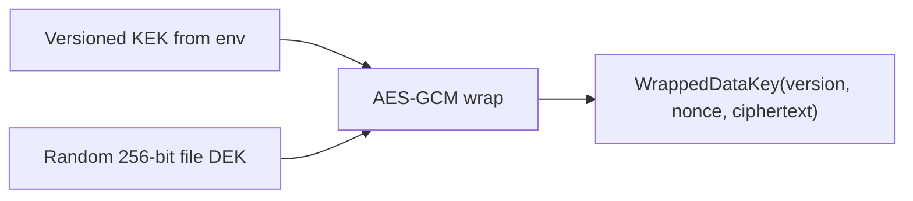
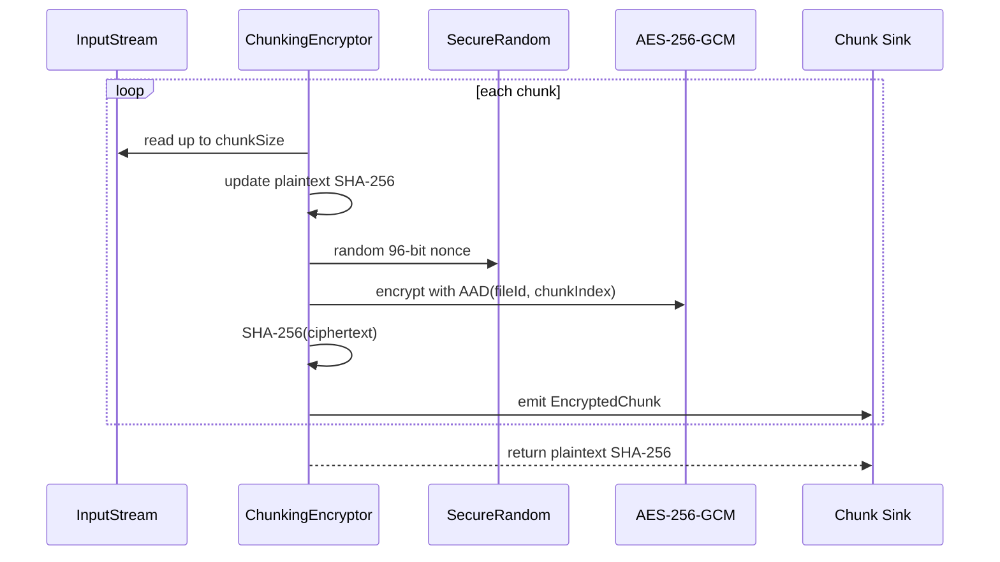

# ShardVault Crypto And Chunking

Layer 1 implements a pure Java crypto library in `backend/crypto`. It has no web,
database, storage-provider, or Spring dependencies.

## Goals

- Providers only receive encrypted opaque chunk blobs.
- Files are streamed in fixed-size chunks, so callers never need to buffer a whole file.
- Every AES-GCM operation uses a fresh random 96-bit nonce.
- Chunk authentication binds ciphertext to both `fileId` and `chunkIndex` through AAD.
- DEKs are wrapped with versioned master KEKs so future rotation can be introduced safely.

## Envelope Encryption

Each file gets a random 256-bit AES data encryption key (DEK). The DEK encrypts file
chunks. The DEK itself is wrapped using a configured 256-bit master key encryption key
(KEK), loaded from environment variables:

- `MASTER_KEY_B64`: unversioned compatibility key, treated as version 1.
- `MASTER_KEY_B64_V1`, `MASTER_KEY_B64_V2`, ...: explicit KEK versions.

Wrapping uses `AES/GCM/NoPadding` with a random 96-bit nonce. The wrapped blob stores:

- KEK version
- wrap nonce
- wrapped DEK ciphertext and GCM tag

If the wrong KEK version or wrong KEK bytes are used, AES-GCM authentication fails and
the library raises `TamperedDataException`.

## Chunk Encryption

The encryptor reads from an `InputStream` into fixed-size chunks. The default chunk size
is 4 MiB and can be configured per `ChunkingEncryptor`.

For each plaintext chunk:

1. Update the streaming SHA-256 digest of the whole plaintext.
2. Generate a fresh random 96-bit AES-GCM nonce.
3. Encrypt with the file DEK.
4. Authenticate AAD made from `fileId` and `chunkIndex`.
5. Compute SHA-256 of the ciphertext blob.
6. Emit `EncryptedChunk(index, nonce, ciphertext, ciphertextSha256, plainSize)`.

The streaming API accepts a per-chunk sink and returns only the final plaintext digest.
This keeps memory bounded to the plaintext chunk, ciphertext chunk, and small crypto
metadata. A convenience `encryptToList` method exists for small tests and fixtures.

## Chunk Decryption

`ChunkDecryptor` verifies each chunk in two steps:

1. Recompute `SHA-256(ciphertext)` and compare it with `ciphertextSha256`.
2. Decrypt with AES-GCM using the same AAD, which verifies the GCM tag.

Checksum mismatch raises `IntegrityException`. GCM authentication failure raises
`TamperedDataException`.

Single-chunk decryption is supported by `decryptChunk`, which later enables HTTP Range
downloads. Full reassembly is supported by `decryptInOrder`, which sorts chunks by index
and writes plaintext to an `OutputStream`.

## Public Interfaces

- `EnvelopeCryptoService.generateDataKey(): SecretKey`
- `EnvelopeCryptoService.wrap(SecretKey dek, int kekVersion): WrappedDataKey`
- `EnvelopeCryptoService.unwrap(WrappedDataKey wrapped): SecretKey`
- `ChunkingEncryptor.encrypt(InputStream plaintext, SecretKey dek, String fileId, Consumer<EncryptedChunk> sink): byte[]`
- `ChunkingEncryptor.encryptToList(InputStream plaintext, SecretKey dek, String fileId): EncryptionResult`
- `ChunkDecryptor.decryptChunk(EncryptedChunk chunk, SecretKey dek, String fileId): byte[]`
- `ChunkDecryptor.decryptInOrder(List<EncryptedChunk> chunks, SecretKey dek, String fileId, OutputStream plaintext): byte[]`

## Non-Goals In This Layer

- No user authentication.
- No database persistence.
- No object storage integration.
- No key management service integration.
- No zero-knowledge mode.
